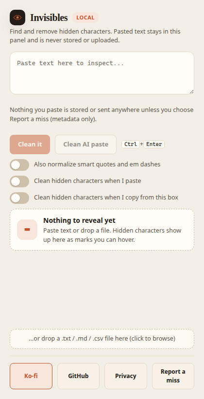
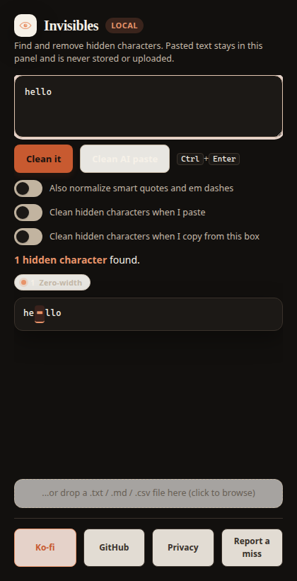

# Invisibles

**Find and remove hidden characters — zero-width spaces, look-alike letters, and bidi controls — entirely on your device.**

[](https://chromewebstore.google.com/detail/ehfmbdppopedenilpgmhofcdibkilmbe)
[](https://github.com/cig13zs/invisibles/actions/workflows/ci.yml)
[](LICENSE)

Install **[Invisibles from the Chrome Web Store](https://chromewebstore.google.com/detail/ehfmbdppopedenilpgmhofcdibkilmbe)** (Chrome, Edge, Brave, Opera), or use the **[web app](https://cig13zs.github.io/invisibles/)** — same engine, no install.

Zero-width spaces, non-breaking spaces that look like real ones, bidi controls, tag characters, and other invisible code points can break CSV imports, string comparison, and search. Look-alike letters can make a hostname resemble a different name, and a bidirectional control can make a diff display differently from the code that runs. Most editors never show them. Invisibles names each hit, highlights where it sits, decodes smuggled “hidden text,” and cleans with one click — offline, with no account and no analytics.

## Features

- **Scan & preview** — category counts, inline marks for where hidden characters sit, decoded messages from tag characters and variation selectors
- **Clean** — remove or replace flagged characters; look-alike spaces become normal spaces; per-category chips to skip a type
- **AI paste** — counts em dashes, smart quotes, and ellipsis without treating them as hidden characters or as proof of authorship. **Clean AI paste** strips hidden characters and turns that punctuation into plain ASCII. Notes call out characters that show up in some chatbot replies, including U+202F, and say plainly that this is not OpenAI’s textGrain watermark
- **Look-alike letters** — mixed-script words, fullwidth and mathematical Latin, and hostnames that resemble another name (with the DNS form). Letters are warnings, not silent rewrites. A word written entirely in Cyrillic or Greek is left alone
- **Code review** — bidirectional overrides and isolates on any pasted line, plus invisibles and look-alike letters on lines that look like code or on added lines of a pasted diff (Trojan Source). The extension does not read GitHub
- **Clean on paste / clean on copy** — off until you turn them on. Both run inside the side panel, so the extension does not need a clipboard permission
- **Badge and tally** — the toolbar badge is the current hidden-character count. A number in local storage counts how many this browser has cleaned. The text is not stored
- **Shortcut** — suggested `Ctrl+Shift+.` (`Command+Shift+.` on Mac) opens the panel. `Ctrl+Enter` cleans. `Ctrl+Shift+Enter` runs Clean AI paste
- **Emoji-safe** — joiners and selectors that belong to real emoji are kept; the summary says how many were preserved
- **Optional punctuation normalize** — smart quotes, em dashes, and ellipsis → plain ASCII (off by default)
- **File drop** — `.txt`, `.md`, `.csv`, `.json`, `.log` (up to 5 MB) in the extension side panel
- **Web app + library** — single `core.js` with no dependencies (`scan`, `clean`, `aiStyle`, `homoglyphs`, `reviewCode`, `decodeHidden`, …)

## Screenshots

| Empty | Hidden characters | Dark |
|---|---|---|
|  |  |  |

Store listing assets (fixed sizes for submission) live in [`store-assets/`](store-assets/).

## Permissions (extension)

| Permission | Why |
|---|---|
| `sidePanel` | Opens Invisibles in Chrome’s side panel when you click the toolbar icon. |
| `storage` | Saves UI switches (`normalizePunct`, `hintDismissed`, `cleanOnPaste`, `cleanOnCopy`) via `chrome.storage.sync`, and a cleaned-character count via `chrome.storage.local`. Not your pasted text. Existing keys are unchanged; the two new switches default to off. |

**Not requested:** `host_permissions`, `tabs`, `scripting`, `clipboardRead`, or any broad site access. The extension cannot read pages you visit. Pasted text is processed in memory only and is not uploaded unless you explicitly use **Report a miss**, which sends metadata (code points and counts) — never your input text.

See [privacy.html](privacy.html) and [SECURITY.md](SECURITY.md).

## Privacy

- No server-side text processing for the web app or extension UI
- No analytics, ads, or remote code execution
- No storage of pasted content (only the UI switches and a cleaned-character count above)
- Open source — audit `core.js`, `extension/popup.js`, and `extension/manifest.json`

## Development

**Requirements:** Node.js 24+, Python 3.13+ (for the deterministic store zip builder).

```bash
# Logic & manifest checks
node core.test.js
node site.test.js
node extension.test.js
node store-assets.test.js

# Deterministic Chrome Web Store zip (+ sha256)
python3 tests/package.test.py
python3 scripts/package.py          # writes dist/invisibles-<version>.zip

# JavaScript syntax (all .js files)
find . -path ./.git -prune -o -name '*.js' -print0 | xargs -0 -n1 node --check

# Extension smoke test (Playwright + Chrome)
npm ci
npx playwright install chromium
npm run test:e2e                    # screenshots → docs/screenshots/
```

**Load unpacked:** `chrome://extensions` → Developer mode → Load unpacked → choose the `extension/` folder.

## Changelog

See [CHANGELOG.md](CHANGELOG.md). Current extension version: **2.0.0**.

Store name, short description, and the note on why page-wide cleaning is not included: [STORE_LISTING.md](STORE_LISTING.md).

## Use as a library

```js
const I = require('./core.js');
I.scan('he\u200Bllo').total;           // 1
I.clean('he\u200Bllo');                // 'hello'
I.decodeHidden(tagSmuggledText);       // hidden ASCII in tags / selectors
I.homoglyphs(text);                    // {findings, urls}
I.reviewCode(diffText).verdict;       // 'clean' | 'review' | 'block'
I.aiStyle(text);                       // punctuation counts and notable spaces
```

`scan()` and `clean()` never throw on bad input.

## Repository layout

```
core.js              Shared engine (web + extension + Node)
index.html           Web app (static, offline-capable)
extension/           Manifest V3 side panel build
scripts/package.py   Reproducible store zip
tests/               Package tests + Playwright e2e
store-assets/        Listing copy and submission screenshots
STORE_LISTING.md     Store name, short description, and why host access stays off
```

## More tools by [cig13zs](https://github.com/cig13zs)

- [Toolfold](https://github.com/cig13zs/toolfold) — local developer utilities in one PWA  
- [Plusminus](https://github.com/cig13zs/plusminus) — measurement uncertainty budgets from instrument specs  
- [Rinse](https://github.com/cig13zs/rinse) — inspect and remove location metadata from photos  

MIT licensed. [Ko-fi](https://ko-fi.com/jju1s) if it saved you a headache.