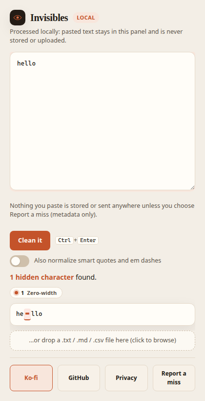

# Invisibles

**Find hidden Unicode in pasted text, see what it is, and strip it — entirely on your device.**

[](https://chromewebstore.google.com/detail/ehfmbdppopedenilpgmhofcdibkilmbe)
[](https://github.com/cig13zs/invisibles/actions/workflows/ci.yml)
[](LICENSE)

Install **[Invisibles from the Chrome Web Store](https://chromewebstore.google.com/detail/ehfmbdppopedenilpgmhofcdibkilmbe)** (Chrome, Edge, Brave, Opera), or use the **[web app](https://cig13zs.github.io/invisibles/)** — same engine, no install.

Zero-width spaces, non-breaking spaces that look like real ones, bidi controls, tag characters, and other invisible code points can break CSV imports, string comparison, and search. Most editors never show them. Invisibles names each hit, highlights where it sits, decodes smuggled “hidden text,” and cleans with one click — offline, with no account and no analytics.

## Features

- **Scan & preview** — category counts, inline marks for where hidden characters sit, decoded messages from tag characters and variation selectors
- **Clean** — remove or replace flagged characters; look-alike spaces become normal spaces; per-category chips to skip a type
- **Emoji-safe** — joiners and selectors that belong to real emoji are kept; the summary says how many were preserved
- **Optional punctuation normalize** — smart quotes, em dashes, and ellipsis → plain ASCII (off by default)
- **File drop** — `.txt`, `.md`, `.csv`, `.json`, `.log` (up to 5 MB) in the extension side panel
- **Web app + library** — single `core.js` with no dependencies (`scan`, `clean`, `decodeHidden`, …)

## Screenshots

| Empty | Hidden characters | Dark |
|---|---|---|
|  |  |  |

Store listing assets (fixed sizes for submission) live in [`store-assets/`](store-assets/).

## Permissions (extension)

| Permission | Why |
|---|---|
| `sidePanel` | Opens Invisibles in Chrome’s side panel when you click the toolbar icon. |
| `storage` | Saves your punctuation-normalize toggle and whether you dismissed the first-run hint (via `chrome.storage.sync` with your Chrome profile — not your pasted text). |

**Not requested:** `host_permissions`, `tabs`, `scripting`, `clipboardRead`, or any broad site access. The extension cannot read pages you visit. Pasted text is processed in memory only and is not uploaded unless you explicitly use **Report a miss**, which sends metadata (code points and counts) — never your input text.

See [privacy.html](privacy.html) and [SECURITY.md](SECURITY.md).

## Privacy

- No server-side text processing for the web app or extension UI
- No analytics, ads, or remote code execution
- No storage of pasted content (only the two UI preferences above)
- Open source — audit `core.js`, `extension/popup.js`, and `extension/manifest.json`

## Development

**Requirements:** Node.js 24+, Python 3.13+ (for the deterministic store zip builder).

```bash
# Logic & manifest checks
node core.test.js
node site.test.js
node extension.test.js
node store-assets.test.js

# Deterministic Chrome Web Store zip (+ sha256)
python3 tests/package.test.py
python3 scripts/package.py          # writes dist/invisibles-<version>.zip

# JavaScript syntax (all .js files)
find . -path ./.git -prune -o -name '*.js' -print0 | xargs -0 -n1 node --check

# Extension smoke test (Playwright + Chrome)
npm ci
npx playwright install chromium
npm run test:e2e                    # screenshots → docs/screenshots/
```

**Load unpacked:** `chrome://extensions` → Developer mode → Load unpacked → choose the `extension/` folder.

## Changelog

See [CHANGELOG.md](CHANGELOG.md). Current extension version: **1.4.1**.

## Use as a library

```js
const I = require('./core.js');
I.scan('he\u200Bllo').total;           // 1
I.clean('he\u200Bllo');                // 'hello'
I.decodeHidden(tagSmuggledText);       // hidden ASCII in tags / selectors
```

`scan()` and `clean()` never throw on bad input.

## Repository layout

```
core.js              Shared engine (web + extension + Node)
index.html           Web app (static, offline-capable)
extension/           Manifest V3 side panel build
scripts/package.py   Reproducible store zip
tests/               Package tests + Playwright e2e
store-assets/        Listing copy and submission screenshots
```

## More tools by [cig13zs](https://github.com/cig13zs)

- [Toolfold](https://github.com/cig13zs/toolfold) — local developer utilities in one PWA  
- [Plusminus](https://github.com/cig13zs/plusminus) — measurement uncertainty budgets from instrument specs  
- [Rinse](https://github.com/cig13zs/rinse) — inspect and remove location metadata from photos  

MIT licensed. [Ko-fi](https://ko-fi.com/jju1s) if it saved you a headache.